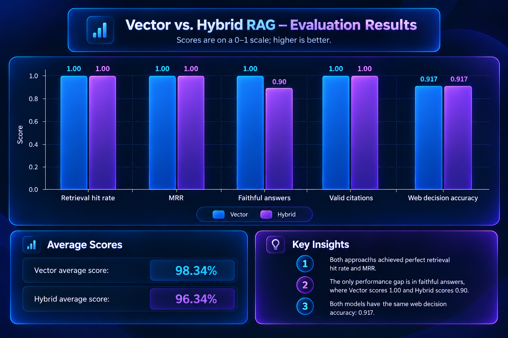

<a id="readme-top"></a>

<div align="center">

[](README.md) [](README.fa.md)


# 🎓 Study Agentic AI

[](https://github.com/kasrakr/Study-Agentic-AI)

یک **پلتفرم یادگیری مبتنی بر RAG عامل‌محور و با اولویت اسناد** است. جزوه‌ها و منابع درسی خود را بارگذاری کنید، از آن‌ها سؤال بپرسید و از یک عامل مبتنی بر **LangGraph** پاسخ‌های **همراه با ارجاع به منبع** بگیرید. عامل ابتدا اسناد شما را جست‌وجو می‌کند، در صورت نیاز پرسش را بازنویسی کرده و دوباره جست‌وجو می‌کند و فقط در صورت لزوم به وب مراجعه می‌کند. همچنین می‌توانید از همان منابع **آزمون** و **فلش‌کارت** بسازید و مباحثی را که در آن‌ها ضعف دارید پیگیری کنید.

<p>
  
  
  
  
  
</p>
<p>
  
  
  
  
  
  
  
</p>

<p>
  
</p>

</div>

---

<div align="center">


</div>

---

<a id="table-of-contents"></a>
## 📖 فهرست مطالب

- [درباره پروژه](#about-the-project)
- [نحوه کار](#how-it-works)
- [قابلیت‌ها](#features)
- [تصاویر محیط برنامه](#screenshots)
- [گراف عامل](#the-agent-graph)
- [بازیابی اطلاعات](#retrieval)
- [ارجاع‌های قابل اعتماد](#citations-you-can-trust)
- [آزمون، فلش‌کارت و پیشرفت](#quizzes-flashcards--progress)
- [چارچوب ارزیابی](#evaluation-harness)
- [فناوری‌های استفاده‌شده](#tech-stack)
- [معماری](#architecture)
- [شروع به کار](#getting-started)
- [پیکربندی](#configuration)
- [مرجع API](#api-reference)
- [آزمایش‌ها](#testing)
- [ساختار پروژه](#project-structure)
- [محدودیت‌ها](#limitations)
- [مجوز](#license)
- [ارتباط](#contact)

---

<a id="about-the-project"></a>
## 🧭 درباره پروژه

بیشتر ابزارهای «گفت‌وگو با PDF» فقط یک‌بار جست‌وجو می‌کنند و سپس پاسخ می‌دهند؛ حتی اگر متن بازیابی‌شده واقعاً پاسخ پرسش را در بر نداشته باشد. **Study Agentic AI** فرایند بازیابی را مرحله‌ای می‌داند که باید کیفیت آن بررسی شود.

ایده اصلی:

> **ابتدا اسناد ← ارزیابی شواهد ← یک بار تلاش مجدد ← وب فقط به‌عنوان آخرین راهکار ← ارجاع برای هر ادعا**

عامل مبتنی بر LangGraph پیام را دسته‌بندی می‌کند، اسناد بارگذاری‌شده را می‌گردد و از یک ارزیاب مبتنی بر LLM می‌پرسد که آیا بخش‌های پیدا‌شده واقعاً به پرسش پاسخ می‌دهند یا خیر. اگر احتمال دهد جست‌وجوی اولیه چیزی را از دست داده است، پرسش را بازنویسی می‌کند و دوباره جست‌وجو را انجام می‌دهد. در نهایت، فقط برای بخش‌های بی‌پاسخ از جست‌وجوی وب (Tavily) استفاده می‌کند. تمام پاسخ‌ها از ارجاع‌هایی ساخته می‌شوند که اعتبارسنجی شده‌اند؛ بنابراین نام فایل، شماره صفحه یا نشانی اینترنتی ساختگیِ تولیدشده توسط مدل نمی‌تواند به‌عنوان منبع پذیرفته شود.

علاوه بر گفت‌وگو، همین منابعِ نمایه‌شده برای ساخت **آزمون‌های خودکار ارزیابی‌شونده**، **فلش‌کارت با درجه سختی** و **داشبورد شناسایی مباحث ضعیف** استفاده می‌شوند.

> ⚠️ این برنامه برای **یک کاربر و اجرای محلی** طراحی شده و **احراز هویت ندارد**. فایل‌ها روی دستگاه شما باقی می‌مانند؛ اما پرسش‌ها و متن اسناد به سرویس سازگار با OpenAI که پیکربندی کرده‌اید ارسال می‌شوند.

<p align="right">(<a href="#readme-top">بازگشت به بالا</a>)</p>

---

<a id="how-it-works"></a>
## ⚙️ نحوه کار


اسناد **صفحه‌به‌صفحه** تقسیم می‌شوند تا هر ارجاع شماره صفحه دقیق خود را حفظ کند. وضعیت مکالمه در SQLite ذخیره می‌شود؛ بنابراین پس از راه‌اندازی مجدد برنامه نیز گفت‌وگوها باقی می‌مانند.

<p align="right">(<a href="#readme-top">بازگشت به بالا</a>)</p>

---

<a id="features"></a>
## ✨ قابلیت‌ها

|  | قابلیت | توضیحات |
|:---:|---|---|
| 📚 | **RAG با اولویت اسناد** | پاسخ‌ها ابتدا از PDFها، فایل‌های `.txt` و فایل‌های Markdown بارگذاری‌شده استخراج می‌شوند. |
| 🤖 | **گردش‌کار عامل‌محور** | ماشین حالت LangGraph قصد کاربر را تشخیص می‌دهد، شواهد را ارزیابی می‌کند، پرسش‌های ضعیف را بازنویسی می‌کند و زمان استفاده از وب را تعیین می‌کند. |
| 🔁 | **بازنویسی محدود پرسش** | اگر احتمال داده شود جست‌وجو نتیجه مهمی را از دست داده، عامل یک بار پرسش را بازنویسی می‌کند (این تعداد قابل پیکربندی است)؛ در نتیجه بی‌دلیل تسلیم نمی‌شود یا وارد حلقه نامحدود نخواهد شد. |
| 🌐 | **استفاده اختیاری از وب** | جست‌وجوی Tavily فقط برای بخش‌هایی انجام می‌شود که اسناد پاسخشان را پوشش نمی‌دهند؛ سپس نتایج از نظر ارتباط و قابلیت اعتماد ارزیابی می‌شوند. |
| 🔎 | **بازیابی ترکیبی (Hybrid)** | امکان ترکیب جست‌وجوی برداری با BM25 و ادغام رتبه‌ها به روش Reciprocal Rank Fusion برای یافتن اصطلاحات دقیق، شناسه‌ها و معادلات. |
| 🧾 | **ارجاع‌های اعتبارسنجی‌شده** | ارجاع‌ها فقط بر اساس فراداده بازیابی‌شده و نتایج واقعی جست‌وجو ساخته می‌شوند؛ منابع ساختگی حذف خواهند شد. |
| ⚡ | **پاسخ جریانی و خط زمانی** | پاسخ‌ها از طریق SSE توکن‌به‌توکن نمایش داده می‌شوند و خط زمانی، مراحل واقعی اجرای عامل را نشان می‌دهد. |
| 📝 | **آزمون‌ها** | پرسش‌های چندگزینه‌ای، درست/نادرست و پاسخ کوتاه همراه با توضیح و ارجاع به منبع. پاسخ‌های کوتاه بر اساس معیار ارزیابی می‌شوند. |
| 🃏 | **فلش‌کارت‌ها** | از اسناد خود دسته فلش‌کارت بسازید و دشواری هر کارت را به‌صورت آسان، متوسط یا دشوار مشخص کنید. |
| 📈 | **داشبورد پیشرفت** | تشخیص شفاف مباحث ضعیف با توجه به اشتباه‌های آزمون و فلش‌کارت‌های دشوار، به‌همراه فعالیت‌های اخیر. |
| 🗂️ | **محدودکردن دامنه گفت‌وگو** | مشخص کنید هر پرسش اجازه دارد در کدام اسناد جست‌وجو کند. |
| 💬 | **تاریخچه مکالمه** | گفت‌وگوهای ماندگار همراه با فهرست مکالمه‌ها که با SQLite checkpointer در LangGraph ذخیره می‌شوند. |
| 🌗 | **حالت روشن و تاریک** | تغییر پوسته با ذخیره ترجیح کاربر، استفاده از ترجیح سیستم‌عامل در صورت نبود انتخاب و بدون چشمک‌زدن هنگام بارگذاری. |
| 🧪 | **چارچوب ارزیابی** | اندازه‌گیری نرخ یافتن سند، MRR، وفاداری پاسخ، اعتبار ارجاع‌ها و دقت تصمیم استفاده از وب روی مجموعه‌ای از نمونه‌ها. |
| 🐳 | **اجرای Docker با یک دستور** | دستور `docker compose up --build` رابط کاربری و API را اجرا می‌کند و داده‌ها در `./storage` باقی می‌مانند. |

<p align="right">(<a href="#readme-top">بازگشت به بالا</a>)</p>

---

<a id="screenshots"></a>
## 🖼️ تصاویر محیط برنامه

### ۱. داشبورد

<div align="center">

</div>

### ۲. گفت‌وگوی مطالعاتی، خط زمانی عامل و منابع

<div align="center">

</div>

### ۳. کتابخانه و بارگذاری فایل

<div align="center">

</div>

### ۴. آزمون

<div align="center">

</div>

### ۵. فلش‌کارت‌ها

<div align="center">

</div>

### ۶. حالت روشن

<div align="center">

</div>

<p align="right">(<a href="#readme-top">بازگشت به بالا</a>)</p>

---

<a id="the-agent-graph"></a>
## 🕸️ گراف عامل

هر پیام گفت‌وگو از یک `StateGraph` در LangGraph عبور می‌کند:


| گره | عملکرد |
|---|---|
| `classify_intent` | پیام را برچسب‌گذاری می‌کند (`study_question`، `explain_simply`، `quiz`، `flashcards`، `smalltalk`)، تشخیص می‌دهد آیا کاربر صراحتاً اطلاعات بیرونی می‌خواهد یا نه و پرسش را طوری بازنویسی می‌کند که بدون تاریخچه چت نیز مستقل و قابل فهم باشد. |
| `retrieve_documents` | نمایه برداری یا نمایه ترکیبی را جست‌وجو می‌کند؛ در صورت انتخاب کاربر، جست‌وجو به اسناد مشخص محدود می‌شود. هنگام تلاش مجدد، نتایج قبلی و جدید ادغام می‌شوند تا بازنویسی فقط بتواند شواهد بیشتری اضافه کند. |
| `grade_document_evidence` | ارزیاب مبتنی بر LLM نتیجه را `sufficient`، `partial` یا `insufficient` مشخص می‌کند و بخش‌های مرتبط، اطلاعات جاافتاده و مفیدبودن جست‌وجو با عبارت‌بندی جدید را گزارش می‌دهد. |
| `rewrite_query` | یک بار پرسش جست‌وجو را بهتر می‌کند؛ اگر عبارت جدید تغییری نداشته باشد، عامل به مرحله بعد می‌رود و همان جست‌وجو را تکرار نمی‌کند. |
| `identify_missing_information` | بخش پاسخ‌داده‌نشده را به یک پرسش کوتاه و عمومی برای جست‌وجوی وب تبدیل می‌کند. |
| `web_search` | در صورت پیکربندی Tavily را فراخوانی می‌کند؛ در غیر این صورت محدودیت را به‌وضوح ثبت می‌کند و با شکست ناگهانی مواجه نمی‌شود. |
| `grade_web_evidence` | فقط نتایجی را نگه می‌دارد که مرتبط تشخیص داده شده‌اند و قابلیت اعتماد پایینی ندارند. |
| `generate_answer` | پاسخ را با استفاده از منابع پذیرفته‌شده به‌صورت جریانی تولید و سپس ارجاع‌ها را اعتبارسنجی می‌کند. اگر هیچ شاهدی موجود نباشد، به‌جای حدس‌زدن این موضوع را اعلام می‌کند. |
| `generate_quiz` / `generate_flashcards` | ابزارهای مطالعه را از اسناد انتخاب‌شده یا آخرین اسناد استفاده‌شده ایجاد می‌کند؛ **هرگز از وب تولید نمی‌کند**. |

تمام گره‌ها در یک دکوراتور `@traced` قرار دارند که رویدادهای واقعی شروع و پایان را همراه با مدت اجرا به جریان ارسال می‌کند. خط زمانی رابط کاربری فقط مراحل **واقعاً اجراشده** را نشان می‌دهد و استدلال درونی مدل را نمایش نمی‌دهد.

<p align="right">(<a href="#readme-top">بازگشت به بالا</a>)</p>

---

<a id="retrieval"></a>
## 🔎 بازیابی اطلاعات

| حالت | نحوه کار | کاربرد پیشنهادی |
|---|---|---|
| `vector` (پیش‌فرض) | محاسبه شباهت کسینوسی بین embeddingهای `text-embedding-3-small` که در ChromaDB ذخیره شده‌اند. | پرسش‌های مفهومی و عبارت‌بندی طبیعی. |
| `hybrid` | جست‌وجوی برداری به‌علاوه جست‌وجوی کلیدواژه‌ای داخلی BM25؛ سپس ادغام نتایج با **Reciprocal Rank Fusion**. | اصطلاحات دقیق، معادلات، کدهای خطا و شناسه‌ها (برای نمونه `XJ-4471`). |

نکته‌ها:

- امتیاز شباهت فقط **نشانه‌ای از ارتباط** است، نه اثبات؛ ارزیاب LLM تعیین می‌کند که متن واقعاً پاسخ پرسش را دارد یا خیر.
- در حالت ترکیبی، نتایجی که فقط از جست‌وجوی کلیدواژه‌ای به دست آمده‌اند حتی با امتیاز کسینوسی پایین حفظ می‌شوند؛ زیرا یافتن عبارت دقیق هدف این حالت است.
- در نمایه ثبت می‌شود که از کدام مدل embedding استفاده شده است. تغییر `OPENAI_EMBEDDING_MODEL` پس از ساخت نمایه، تا زمان بازسازی نمایه، خطای ناسازگاری واضحی ایجاد می‌کند.
- پیش از تغییر حالت، عملکرد آن‌ها را اندازه‌گیری کنید:

```bash
python -m app.evals.run --compare-retrieval
```

<p align="right">(<a href="#readme-top">بازگشت به بالا</a>)</p>

---

<a id="citations-you-can-trust"></a>
## 🧾 ارجاع‌هایی که می‌توان به آن‌ها اعتماد کرد

پاسخ‌ها از نشانه‌هایی مانند `[D1]` (بخش برگرفته از سند) و `[W1]` (نتیجه وب) استفاده می‌کنند. سپس بک‌اند این مراحل را انجام می‌دهد:

1. هر نشانه را به یک بخش واقعی بازیابی‌شده یا نتیجه واقعی جست‌وجو متصل می‌کند.
2. هر نشانه‌ای را که مدل از خود ساخته باشد حذف می‌کند.
3. نشانه‌های گروه‌بندی‌شده را یکدست می‌کند؛ برای مثال `[D1, W2]` به `[D1][W2]` تبدیل می‌شود.
4. اطلاعات ارجاع (نام فایل، شماره صفحه، گزیده متن و URL) را **فقط از فراداده ذخیره‌شده** می‌سازد، نه از متن تولیدشده توسط مدل.

نتیجه همچنین دارای فیلد `answer_origin` است که می‌تواند یکی از این مقادیر باشد: `documents`، `web`، `documents_and_web` یا `none`. علاوه بر آن، توضیح صادقانه‌ای درباره محدودیت‌ها برمی‌گرداند؛ مثلاً وقتی بخشی از پرسش پیدا نشده، جست‌وجوی وب شکست خورده یا هیچ منبعی قابل ارجاع نیست.

<div align="center">

</div>

<p align="right">(<a href="#readme-top">بازگشت به بالا</a>)</p>

---

<a id="quizzes-flashcards--progress"></a>
## 🧠 آزمون، فلش‌کارت و پیشرفت

**آزمون‌ها** — اسناد، درجه سختی، تعداد پرسش (به‌طور پیش‌فرض حداکثر ۲۰ سؤال) و نوع پرسش‌ها را انتخاب کنید.

- پرسش‌های چندگزینه‌ای و درست/نادرست به‌صورت خودکار نمره‌گذاری می‌شوند.
- پاسخ‌های کوتاه با کمک LLM و بر اساس یک معیار ارزیابی می‌شوند؛ نتیجه آن‌ها در گزارش به‌عنوان *تخمین* مشخص می‌شود.
- هر پرسش به سند، صفحه و بخش متن مربوط به منبع خود ارجاع می‌دهد.

**فلش‌کارت‌ها** — دسته‌هایی با حداکثر ۳۰ کارت به‌صورت پیش‌فرض بسازید و دشواری هر کارت را **آسان**، **متوسط** یا **دشوار** ارزیابی کنید.

**پیشرفت** — وضعیت مستقیماً از تلاش‌ها و درجه‌بندی‌های ذخیره‌شده محاسبه می‌شود. قانون عمداً ساده و شفاف است:

> یک مبحث زمانی ضعیف علامت‌گذاری می‌شود که دست‌کم **۲ نتیجه** (پاسخ‌های آزمون به‌علاوه فلش‌کارت‌های ارزیابی‌شده) داشته باشد و **حداقل نیمی از آن‌ها** نادرست پاسخ داده شده یا «دشوار» علامت خورده باشند.

هیچ «امتیاز تسلطی» ساختگی تولید نمی‌شود؛ داشبورد فقط چیزهایی را گزارش می‌کند که در آن‌ها اشتباه کرده‌اید یا برایتان دشوار بوده‌اند و روش محاسبه را نیز در رابط کاربری توضیح می‌دهد.

<p align="right">(<a href="#readme-top">بازگشت به بالا</a>)</p>

---

<a id="evaluation-harness"></a>
## 🧪 چارچوب ارزیابی

مخزن شامل یک مجموعه ارزیابی کوچک (`evals/questions.jsonl`، شامل ۱۲ پرسش) روی چهار سند نمونه در مسیر `evals/documents/` است: فتوسنتز، قوانین نیوتن، نمادگذاری Big-O و یک راهنمای آزمایشگاه دارای کد. ارزیابی از **نمایه موقت** استفاده می‌کند و به کتابخانه شخصی اسناد شما دست نمی‌زند.

```bash
cd backend
python -m app.evals.run                       # اجرای کامل (با مصرف اعتبار API)
python -m app.evals.run --limit 5             # فقط پنج پرسش اول
python -m app.evals.run --no-judge            # رد کردن ارزیاب وفاداری مبتنی بر LLM
python -m app.evals.run --retrieval-only      # فقط embedding؛ بدون فراخوانی چت
python -m app.evals.run --compare-retrieval   # مقایسه vector با hybrid
python -m app.evals.run --mode hybrid         # پاسخ‌گویی با بازیابی ترکیبی
```

| معیار | چه چیزی را می‌سنجد؟ |
|---|---|
| **نرخ یافتن نتیجه / MRR** | آیا سند مورد انتظار در متن‌های بازیابی‌شده وجود داشته و چه رتبه‌ای داشته است؟ |
| **وفاداری (Faithfulness)** | سهم پاسخ‌هایی که ارزیاب LLM تمام ادعاهای آن‌ها را مستند دانسته است، به‌علاوه یادآوری نکات کلیدی. |
| **اعتبار ارجاع‌ها** | بررسی قطعی می‌کند که هر بخش ارجاع‌شده وجود داشته باشد، با فایل منطبق باشد و گزیده نقل‌شده واقعاً با ابتدای آن بخش تطبیق کند؛ URLهای وب نیز باید از ارائه‌دهنده جست‌وجو برگشته باشند. |
| **دقت تصمیم استفاده از وب** | آیا در زمان نیاز از وب استفاده شده و در زمان بی‌نیازی از آن پرهیز شده است؟ فراخوانی‌های جاافتاده و غیرضروری جداگانه شمرده می‌شوند. |
| **تأخیر و توکن‌ها** | میانگین، میانه و حداکثر تأخیر و مجموع توکن‌های مصرف‌شده، در صورت گزارش‌شدن. |

گزارش JSON در مسیر `evals/results/` ذخیره می‌شود.

### نتایج

| معیار | Vector | Hybrid |
|---|---:|---:|
| نرخ یافتن نتیجه در بازیابی | 1.0 | 1.0 |
| MRR | 1.0 | 1.0 |
| پاسخ‌های وفادار (همه ادعاها پشتیبانی شده‌اند) | 1.0 | 0.9 |
| ارجاع‌های معتبر | 1.0 | 1.0 |
| دقت تصمیم استفاده از وب | 0.917 | 0.917 |

<div align="center">

</div>

<p align="right">(<a href="#readme-top">بازگشت به بالا</a>)</p>

---

<a id="tech-stack"></a>
## 🧱 فناوری‌های استفاده‌شده

<div align="center">


</div>

### اجزای اصلی

| لایه | فناوری |
|---|---|
| API | FastAPI + Uvicorn، Pydantic v2 / pydantic-settings |
| هماهنگ‌سازی عامل | LangGraph (`StateGraph`) همراه با `langgraph-checkpoint-sqlite` |
| مدل زبانی و embedding | هر endpoint سازگار با OpenAI (مدل‌های پیش‌فرض: `gpt-4o-mini` و `text-embedding-3-small`) |
| ذخیره‌سازی برداری | ChromaDB از طریق `langchain-chroma` |
| جست‌وجوی کلیدواژه‌ای | BM25 داخلی + ادغام رتبه‌ها با Reciprocal Rank Fusion |
| پردازش اسناد | PyMuPDF برای PDF و بارگذارهای متن ساده و Markdown |
| قطعه‌بندی متن | `RecursiveCharacterTextSplitter` (به‌صورت پیش‌فرض ۱۰۰۰ کاراکتر با هم‌پوشانی ۱۵۰ کاراکتری) |
| جست‌وجوی وب | Tavily (اختیاری و قابل جایگزینی از طریق رابط provider) |
| پایگاه داده برنامه | SQLite + SQLAlchemy 2 برای اسناد، مکالمه‌ها، آزمون‌ها، تلاش‌ها و فلش‌کارت‌ها |
| رابط کاربری | React 19، React Router 7، TypeScript، Vite، Tailwind CSS 4، `react-markdown` + `remark-gfm` و آیکون‌های Lucide |
| آزمایش‌ها | pytest برای بک‌اند؛ Vitest + Testing Library برای فرانت‌اند |
| استقرار | Docker Compose و Nginx برای ارائه SPA ساخته‌شده |

<p align="right">(<a href="#readme-top">بازگشت به بالا</a>)</p>

---

<a id="architecture"></a>
## 🏗️ معماری

### نمای کلی سیستم


### جریان ورود و پردازش اسناد


### تصمیم‌های طراحی

- **اولویت با اسناد.** همیشه اسناد ابتدا جست‌وجو می‌شوند؛ وب فقط برای اطلاعات ناقص یا زمانی استفاده می‌شود که کاربر صراحتاً درخواست کند.
- **محدودیت برای همه مراحل.** تعداد بازنویسی پرسش‌ها، طول تاریخچه، حجم فایل بارگذاری، تعداد صفحات، اندازه آزمون و دفعات تلاش مجدد provider همگی سقف دارند.
- **یک لایه تلاش مجدد.** تلاش مجدد در سطح SDK غیرفعال است تا تنها یک لایه محدود، خطاهای موقتی provider را دوباره امتحان کند؛ کلید نامعتبر، اعتبار API ناکافی و مدل ناشناخته فوراً با پیام پاک‌سازی‌شده گزارش می‌شوند.
- **بررسی پیکربندی در آغاز.** نبود کلیدها یا تنظیمات نامعتبر در زمان راه‌اندازی با پیام واضح متوقف می‌شوند، نه هنگام اولین درخواست.
- **محتوای وب غیرقابل اعتماد است.** نتایج جست‌وجو داده محسوب می‌شوند، نه دستورالعمل.
- **امکان تعویض provider.** عامل به پروتکل `WebSearchProvider` وابسته است؛ بنابراین می‌توان موتور جست‌وجوی دیگری افزود، بدون آن‌که گراف تغییر کند.
- **بازیابی پس از crash.** اسنادی که هنگام خرابی در میانه نمایه‌سازی مانده‌اند، در راه‌اندازی بعدی `failed` علامت می‌خورند.
- **تزریق وابستگی برای آزمون‌ها.** تابع `create_app()` مدل‌های چت، embeddingها و providerهای جست‌وجوی ساختگی را می‌پذیرد.

<p align="right">(<a href="#readme-top">بازگشت به بالا</a>)</p>

---

<a id="getting-started"></a>
## 🚀 شروع به کار

### پیش‌نیازها

- یک **کلید API سازگار با OpenAI** (الزامی). هزینه API جدا از اشتراک ChatGPT محاسبه می‌شود.
- یک **کلید Tavily API** (اختیاری) برای جست‌وجوی جایگزین وب.
- **Docker + Docker Compose** یا برای نصب دستی **Python 3.11 یا بالاتر** و **Node 22 یا بالاتر**.

### روش A — Docker (پیشنهادی)

```bash
git clone https://github.com/kasrakr/Study-Agentic-AI.git
cd Study-Agentic-AI

cp backend/.env.example backend/.env
# فایل backend/.env را ویرایش کنید و OPENAI_API_KEY را تنظیم کنید؛
# در صورت نیاز OPENAI_BASE_URL و TAVILY_API_KEY را نیز تنظیم کنید.

docker compose up --build
```

برنامه را در **http://localhost:5173** باز کنید. API در **http://localhost:8000** اجرا می‌شود و مستندات تعاملی آن در مسیر `/docs` قرار دارد.

اسناد، نمایه و مکالمه‌های شما در `./storage` باقی می‌مانند.

### روش B — اجرای محلی

**بک‌اند**

```bash
cd backend
python -m venv .venv
source .venv/bin/activate          # ویندوز: .venv\Scripts\activate
pip install -e ".[dev]"

cp .env.example .env               # سپس OPENAI_API_KEY را تنظیم کنید
uvicorn app.main:create_app --factory --reload
```

**فرانت‌اند** (در ترمینالی جداگانه)

```bash
cd frontend
cp .env.example .env               # VITE_API_BASE_URL=http://localhost:8000
npm install
npm run dev
```

### فهرست بررسی اجرای نخست

1. داشبورد را باز کنید و مطمئن شوید وضعیت بک‌اند متصل است.
2. با گزینه **Check OpenAI** در داشبورد (یا `GET /api/health/openai`) کلید، مدل‌ها و اعتبار مالی را با دو درخواست واقعی و کوچک بررسی کنید.
3. به بخش **Library** بروید، یک فایل PDF، `.txt` یا `.md` بارگذاری کنید و منتظر بمانید وضعیت آن به *indexed* تغییر کند.
4. **Study chat** را باز کنید و درباره سند خود سؤالی بپرسید.

<div align="center">

</div>

<p align="right">(<a href="#readme-top">بازگشت به بالا</a>)</p>

---

<a id="configuration"></a>
## 🔧 پیکربندی

تمام تنظیمات از متغیرهای محیطی یا فایل `backend/.env` دریافت می‌شوند و در یک محل تعریف شده‌اند: `backend/app/config.py`.

| متغیر | مقدار پیش‌فرض | توضیحات |
|---|---|---|
| `OPENAI_API_KEY` | *(الزامی)* | کلید endpoint پیکربندی‌شده. |
| `OPENAI_BASE_URL` | `https://api.gapgpt.app/v1` | endpoint سازگار با OpenAI برای چت و embedding. برای استفاده مستقیم از OpenAI، آن را روی `https://api.openai.com/v1` بگذارید. |
| `OPENAI_CHAT_MODEL` | `gpt-4o-mini` | مدل مورد استفاده برای تمام عملیات LLM. |
| `OPENAI_EMBEDDING_MODEL` | `text-embedding-3-small` | تغییر این مقدار در آینده مستلزم ساخت مجدد نمایه برداری است. |
| `OPENAI_TIMEOUT_SECONDS` / `OPENAI_MAX_RETRIES` | `60` / `2` | مهلت پاسخ provider و تعداد تلاش مجدد محدود. |
| `TAVILY_API_KEY` | *(خالی)* | جست‌وجوی جایگزین وب را فعال می‌کند. بدون این کلید، پرسش‌های بی‌پاسخ با اعلام محدودیت مشخص روبه‌رو می‌شوند. |
| `TAVILY_MAX_RESULTS` / `TAVILY_TIMEOUT_SECONDS` | `5` / `10` | محدودیت تعداد نتایج و زمان انتظار جست‌وجوی وب. |
| `DATABASE_URL` | `sqlite:///storage/study.db` | پایگاه داده برنامه. |
| `CHROMA_PERSIST_DIRECTORY` | `storage/vectorstore` | محل ذخیره نمایه برداری. |
| `CHECKPOINT_DATABASE` | `storage/checkpoints.sqlite` | وضعیت مکالمه‌های LangGraph. |
| `UPLOAD_DIRECTORY` | `storage/uploads` | فایل‌های بارگذاری‌شده. |
| `CORS_ORIGINS` | `http://localhost:5173,http://127.0.0.1:5173` | مبدأهای مجاز مرورگر. |
| `MAX_UPLOAD_SIZE_MB` / `MAX_DOCUMENT_PAGES` | `25` / `500` | سقف حجم فایل و تعداد صفحات سند. |
| `CHUNK_SIZE` / `CHUNK_OVERLAP` | `1000` / `150` | اندازه قطعه متن و میزان هم‌پوشانی؛ مقدار هم‌پوشانی باید از اندازه قطعه کمتر باشد. |
| `RETRIEVAL_TOP_K` | `6` | تعداد بخش‌های بازیابی‌شده در هر جست‌وجو. |
| `RETRIEVAL_MIN_SCORE` | `0.0` | بخش‌هایی با شباهت کسینوسی کمتر از این مقدار حذف می‌شوند؛ مقدار `0` این فیلتر را غیرفعال می‌کند. |
| `RETRIEVAL_MODE` | `vector` | یکی از حالت‌های `vector` یا `hybrid`. |
| `RETRIEVAL_WEAK_SCORE` | `0.25` | اگر بیشترین امتیاز شباهت کمتر از این مقدار باشد، بازیابی ضعیف تلقی می‌شود. |
| `MAX_RETRIEVAL_RETRIES` | `1` | تعداد دفعات بازنویسی پرسش پیش از جست‌وجوی وب. |
| `AGENT_HISTORY_MESSAGES` | `6` | تعداد پیام‌های قبلی که در اختیار دسته‌بند قرار می‌گیرند. |
| `QUIZ_MAX_QUESTIONS` / `FLASHCARD_MAX_CARDS` | `20` / `30` | سقف تعداد سؤال‌های آزمون و کارت‌های فلش‌کارت. |
| `GENERATION_CONTEXT_CHUNKS` | `24` | تعداد بخش‌های نمونه‌برداری‌شده برای تولید هر آزمون یا دسته کارت. |
| `LOG_LEVEL` | `INFO` | سطح ثبت رویدادها؛ کلیدها از لاگ‌ها حذف می‌شوند. |
| `VITE_API_BASE_URL` *(فرانت‌اند)* | `http://localhost:8000` | نشانی بک‌اند از دید مرورگر. |

<p align="right">(<a href="#readme-top">بازگشت به بالا</a>)</p>

---

<a id="api-reference"></a>
## 🔌 مرجع API

پس از اجرای بک‌اند، مستندات تعاملی Swagger در مسیر **`/docs`** در دسترس است. همه خطاها از یک ساختار استفاده می‌کنند: `{"error": {"code", "message", "details"}}`.

| بخش | روش و مسیر | کاربرد |
|---|---|---|
| **سلامت سرویس** | `GET /api/health` | بررسی ساده فعال‌بودن سرویس؛ بدون فراخوانی OpenAI و بدون بازگرداندن مقادیر کلیدها. |
| | `GET /api/health/openai` | دو درخواست واقعی کوچک برای بررسی کلید، مدل‌ها و اعتبار مالی. |
| **اسناد** | `POST /api/documents/upload` | بارگذاری و نمایه‌سازی فایل PDF / TXT / Markdown. |
| | `GET /api/documents` | فهرست اسناد و وضعیت نمایه‌سازی آن‌ها. |
| | `GET /api/documents/{id}` | جزئیات سند. |
| | `GET /api/documents/{id}/file` | دریافت فایل اصلی. |
| | `DELETE /api/documents/{id}` | حذف سند و بردارهای آن. |
| **گفت‌وگو** | `POST /api/chat` | ارسال پرسش و دریافت پاسخ کامل. |
| | `POST /api/chat/stream` | همان عملیات با جریان Server-Sent Events (توکن‌ها و رویدادهای مراحل عامل). |
| **مکالمه‌ها** | `GET /api/conversations` | فهرست مکالمه‌ها. |
| | `GET /api/conversations/{id}` | تاریخچه یک مکالمه. |
| | `DELETE /api/conversations/{id}` | حذف مکالمه. |
| **آزمون‌ها** | `POST /api/quizzes/generate` | تولید آزمون از اسناد انتخاب‌شده. |
| | `GET /api/quizzes/{id}` | دریافت یک آزمون. |
| | `POST /api/quizzes/{id}/submit` | ثبت پاسخ‌ها و دریافت نتیجه ارزیابی‌شده. |
| **فلش‌کارت‌ها** | `POST /api/flashcards/generate` | ایجاد دسته فلش‌کارت. |
| | `GET /api/flashcards/{id}` | دریافت یک دسته کارت. |
| | `PUT /api/flashcards/cards/{id}/difficulty` | تعیین دشواری کارت: آسان، متوسط یا دشوار. |
| **پیشرفت** | `GET /api/progress` | آمار آزمون و فلش‌کارت، مباحث ضعیف و فعالیت‌های اخیر. |

<p align="right">(<a href="#readme-top">بازگشت به بالا</a>)</p>

---

<a id="testing"></a>
## ✅ آزمایش‌ها

```bash
# بک‌اند (کاملاً شبیه‌سازی‌شده؛ بدون نیاز به کلید API یا شبکه)
cd backend
pytest

# فرانت‌اند
cd frontend
npm test            # vitest
npm run typecheck   # tsc --noEmit
npm run build       # typecheck + ساخت نسخه production
```

مجموعه آزمون بک‌اند (حدود ۱۸۰ آزمون) گراف عامل و مسیریابی، بازیابی ترکیبی، بارگذارها و قطعه‌بندی، API اسناد، جریان پاسخ و مکالمه‌ها، آزمون‌ها، فلش‌کارت‌ها، پیشرفت، مدیریت خطا و تلاش مجدد، اعتبارسنجی تنظیمات، جست‌وجوی وب، معیارهای ارزیابی و یک جریان کامل انتهابه‌انتها را پوشش می‌دهد. همه آزمون‌ها از مدل‌های ساختگی تزریق‌شده استفاده می‌کنند؛ بنابراین بدون اتصال به شبکه نیز اجرا می‌شوند.

**آزمایش رابط کاربری بدون کلید API** (پاسخ‌های از پیش نوشته‌شده؛ فقط برای توسعه):

```bash
cd backend
python scripts/fake_server.py --port 8766 --tavily
```

اسکریپت `scripts/smoke_live.py` یک آزمایش سریع روی سرور زنده اجرا می‌کند.

<p align="right">(<a href="#readme-top">بازگشت به بالا</a>)</p>

---

<a id="project-structure"></a>
## 📂 ساختار پروژه


<p align="right">(<a href="#readme-top">بازگشت به بالا</a>)</p>

---

<a id="limitations"></a>
## ⚠️ محدودیت‌ها

- **تک‌کاربره و بدون احراز هویت** — برای استفاده محلی در نظر گرفته شده است.
- **فرمت‌های قابل پشتیبانی:** PDF، فایل‌های `.txt`، `.md` و `.markdown`. **PDFهای اسکن‌شده پشتیبانی نمی‌شوند** (OCR وجود ندارد). فایل‌های PDF رمزدار رد می‌شوند.
- **حریم خصوصی:** فایل‌ها محلی باقی می‌مانند، اما پرسش‌ها و متن اسناد به provider سازگار با OpenAI که تنظیم کرده‌اید فرستاده می‌شوند؛ هنگام اجرای جست‌وجوی جایگزین وب، پرسش‌ها به Tavily نیز ارسال خواهند شد.
- **ارزیابی پاسخ کوتاه با هوش مصنوعی** تخمینی است؛ پرسش‌های چندگزینه‌ای و درست/نادرست به شکل قطعی نمره‌گذاری می‌شوند.
- **برچسب‌های موضوعی مباحث ضعیف** توسط مدل تولید می‌شوند؛ بنابراین ممکن است موضوعات مشابه به چند دسته جدا تقسیم شوند.
- برای تغییر مدل embedding باید پوشه `storage/vectorstore` را حذف و اسناد را دوباره بارگذاری کنید.

<p align="right">(<a href="#readme-top">بازگشت به بالا</a>)</p>

---

<a id="license"></a>
## 📄 مجوز

این پروژه تحت **مجوز MIT** منتشر شده است. برای جزئیات، فایل [`LICENSE`](./LICENSE) را ببینید.

<p align="right">(<a href="#readme-top">بازگشت به بالا</a>)</p>

---

<a id="contact"></a>
## 📬 ارتباط

**Kasra Karimian**

<div align="center">

<a href="https://github.com/kasrakr">
  
</a>
<a href="https://linkedin.com/in/kasrakarimian">
  
</a>
<a href="https://t.me/lowkasra">
  
</a>

</div>

<p align="right">(<a href="#readme-top">بازگشت به بالا</a>)</p>

---

<details>
<summary>⭐ تاریخچه ستاره‌های مخزن</summary>

</details>

<div align="center">

اگر این پروژه به مطالعه شما کمک کرده یا گردش‌کار عامل برایتان مفید بوده است، با دادن یک ⭐ از مخزن حمایت کنید.

</div>


