<a id="readme-top"></a>

<div align="center">

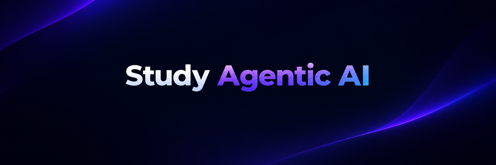

# 🎓 Study Agentic AI

[](https://github.com/kasrakr/Study-Agentic-AI)

A **document-first agentic RAG learning platform**. Upload your own study material, ask questions, and get **cited answers** from a **LangGraph** agent that searches your documents first, retries with a rewritten query, and only falls back to the web when it has to. Generate **quizzes** and **flashcards** from the same material and track your weak topics.

<p>
  
  
  
  
  
</p>
<p>
  
  
  
  
  
  
  
</p>

<p>
  
</p>

</div>

---

<div align="center">

<!-- 🖼️ IMAGE SLOT 1 — HERO: a wide screenshot (or short GIF) of the Study Chat page streaming an answer with citations.
     Suggested file: docs/images/hero.png  ·  Suggested width: 900 -->
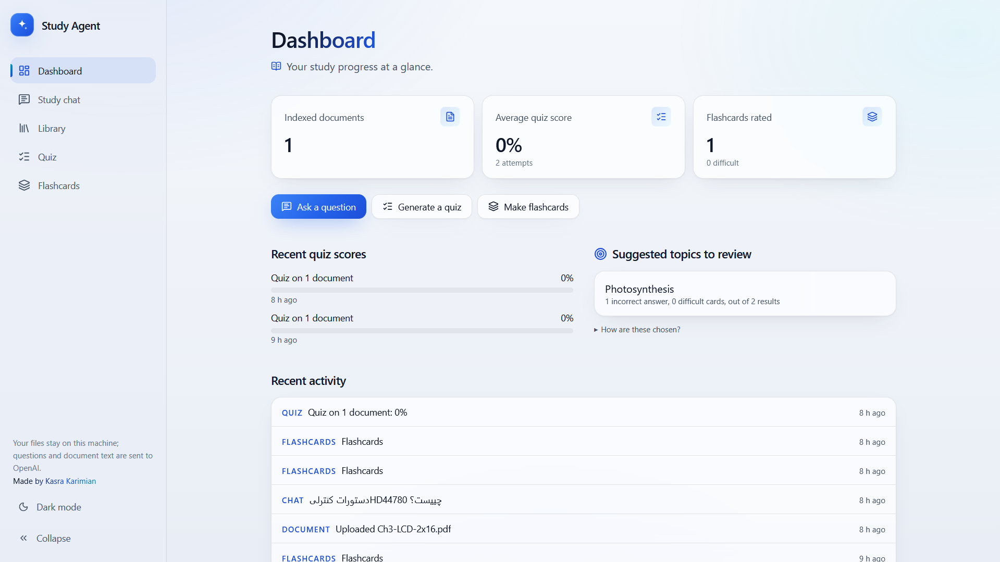

</div>

---

## 📖 Table of Contents

- [About the Project](#-about-the-project)
- [How It Works](#-how-it-works)
- [Features](#-features)
- [Screenshots](#-screenshots)
- [The Agent Graph](#-the-agent-graph)
- [Retrieval](#-retrieval)
- [Citations You Can Trust](#-citations-you-can-trust)
- [Quizzes, Flashcards & Progress](#-quizzes-flashcards--progress)
- [Evaluation Harness](#-evaluation-harness)
- [Tech Stack](#-tech-stack)
- [Architecture](#-architecture)
- [Getting Started](#-getting-started)
- [Configuration](#-configuration)
- [API Reference](#-api-reference)
- [Testing](#-testing)
- [Project Structure](#-project-structure)
- [Limitations](#-limitations)
- [License](#-license)
- [Contact](#-contact)

---

## 🧭 About the Project

Most "chat with your PDF" tools retrieve once and answer, whether or not the retrieved text actually contains the answer. **Study Agentic AI** treats retrieval as something to be *checked*.

The core idea:

> **Documents first → grade the evidence → retry once → web only as a last resort → cite every claim**

A LangGraph agent classifies each message, searches your uploaded documents, asks an LLM grader whether the passages really answer the question, rewrites the query if retrieval may have missed, and only then searches the web (Tavily) for *just the missing part*. Every answer is built from validated citations, so a source can never contain a model-invented filename, page, or URL.

On top of the chat, the same indexed material powers **auto-graded quizzes**, **flashcards with difficulty ratings**, and a **dashboard that flags your weak topics**.

> ⚠️ This is a **single-user local app** and has **no authentication**. Your files stay on your machine; questions and document text are sent to the configured OpenAI-compatible endpoint.

<p align="right">(<a href="#readme-top">back to top</a>)</p>

---

## ⚙️ How It Works

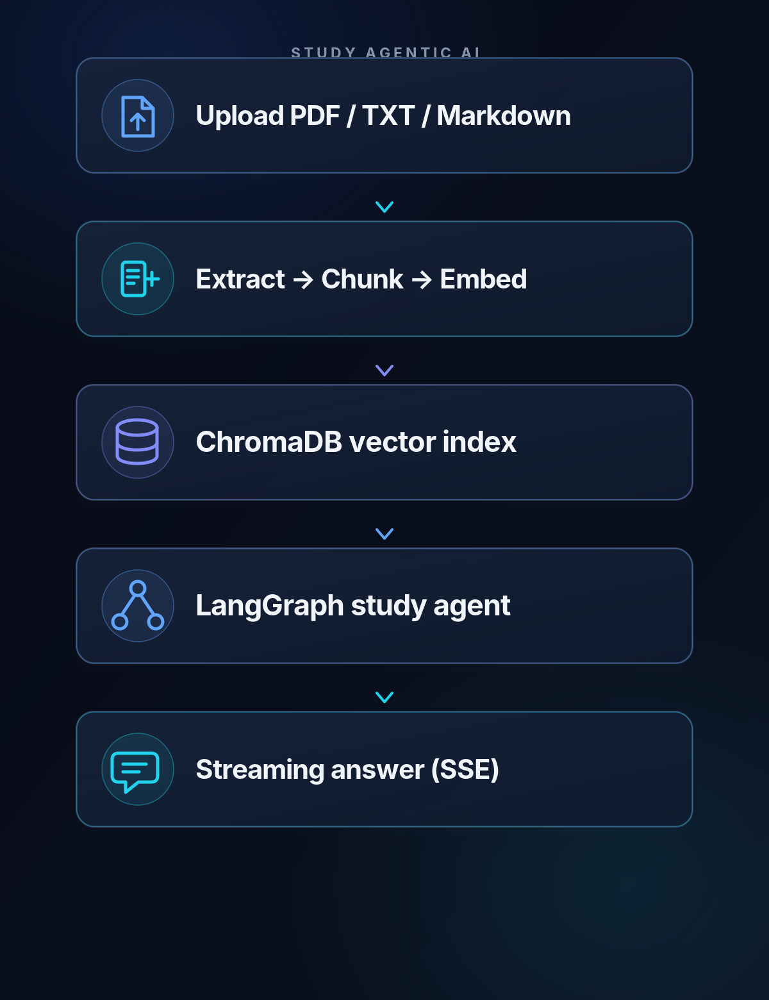

Documents are split **page by page** so every citation keeps an exact page number. Conversation state is checkpointed to SQLite, so chats survive restarts.

<p align="right">(<a href="#readme-top">back to top</a>)</p>

---

## ✨ Features

|     | Feature | Description |
|:---:|---|---|
| 📚 | **Document-First RAG** | Answers come from your uploaded PDFs, `.txt`, and Markdown files before anything else. |
| 🤖 | **Agentic Workflow** | A LangGraph state machine classifies intent, grades evidence, rewrites weak queries, and decides when to use the web. |
| 🔁 | **Bounded Query Rewrite** | If retrieval may have missed, the agent rewrites the query once (configurable) instead of giving up or looping. |
| 🌐 | **Web Fallback (Optional)** | Tavily search runs only for the part the documents can't answer, and results are graded for relevance and reliability. |
| 🔎 | **Hybrid Retrieval** | Switch from pure vector search to vector + BM25 with reciprocal-rank fusion for exact terms, identifiers, and equations. |
| 🧾 | **Validated Citations** | Citations are built from retrieved metadata and real search results only — hallucinated sources are dropped. |
| ⚡ | **Streaming + Timeline** | Answers stream token by token over SSE, next to a real timeline of the agent steps that actually ran. |
| 📝 | **Quizzes** | Multiple-choice, true/false, and short-answer questions with explanations and source references. Short answers are graded by rubric. |
| 🃏 | **Flashcards** | Generate decks from your documents and rate each card *easy / medium / difficult*. |
| 📈 | **Progress Dashboard** | Transparent weak-topic detection from quiz mistakes and difficult flashcards, plus recent activity. |
| 🗂️ | **Scoped Chat** | Pick which documents a question may search. |
| 💬 | **Conversation History** | Persistent chats with a conversation list, stored via LangGraph's SQLite checkpointer. |
| 🌗 | **Light & Dark Mode** | Theme toggle with saved preference, OS-preference fallback, and no flash on load. |
| 🧪 | **Evaluation Harness** | Measure retrieval hit rate / MRR, faithfulness, citation validity, and web-decision accuracy on a sample set. |
| 🐳 | **One-Command Docker** | `docker compose up --build` runs the API and the UI, with data persisted to `./storage`. |

<p align="right">(<a href="#readme-top">back to top</a>)</p>

---

## 🖼️ Screenshots

### 1. Dashboard

<div align="center">

<!-- 🖼️ IMAGE SLOT 2 — Dashboard: system status, indexed docs, quiz stats, weak topics, recent activity -->
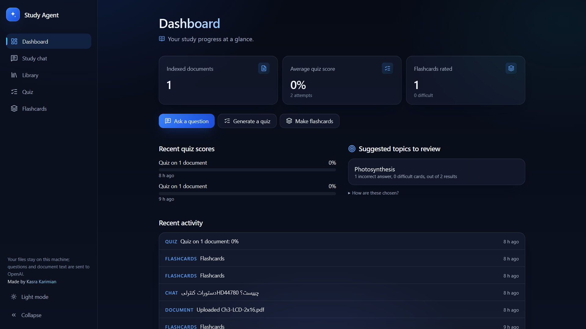

</div>

### 2. Study Chat with Agent Timeline & Sources

<div align="center">

<!-- 🖼️ IMAGE SLOT 3 — Study Chat: streamed answer, [D1]/[W1] citation chips, agent timeline, sources panel -->
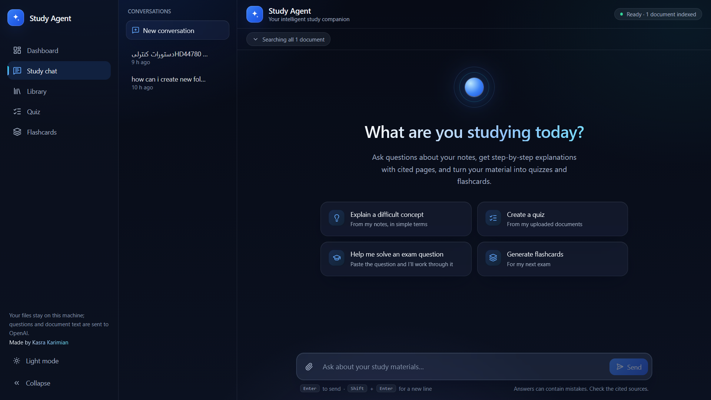

</div>

### 3. Library & Upload

<div align="center">

<!-- 🖼️ IMAGE SLOT 4 — Library: drag-and-drop upload zone + document list with indexing status -->
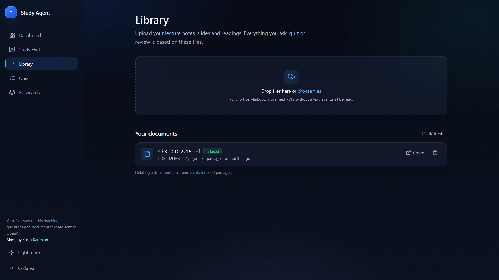

</div>

### 4. Quiz

<div align="center">

<!-- 🖼️ IMAGE SLOT 5 — Quiz: setup screen, a question being answered, and the results page -->
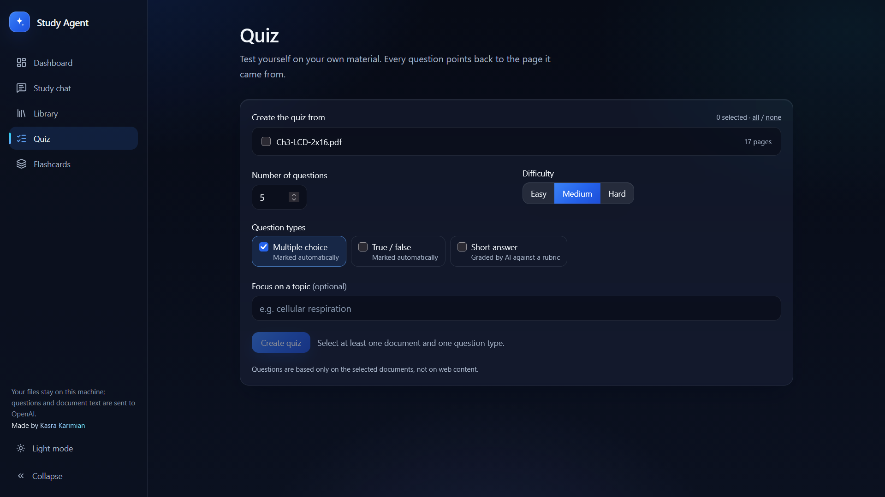

</div>

### 5. Flashcards

<div align="center">

<!-- 🖼️ IMAGE SLOT 6 — Flashcards: card viewer with easy / medium / difficult rating -->
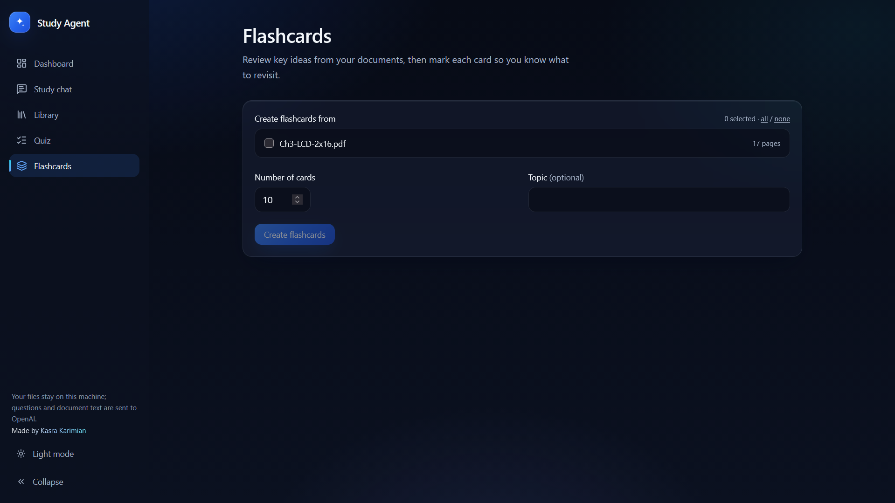

</div>

### 6. Light Mode

<div align="center">

<!-- 🖼️ IMAGE SLOT 7 — Light mode: same page in light theme (or a side-by-side dark | light) -->
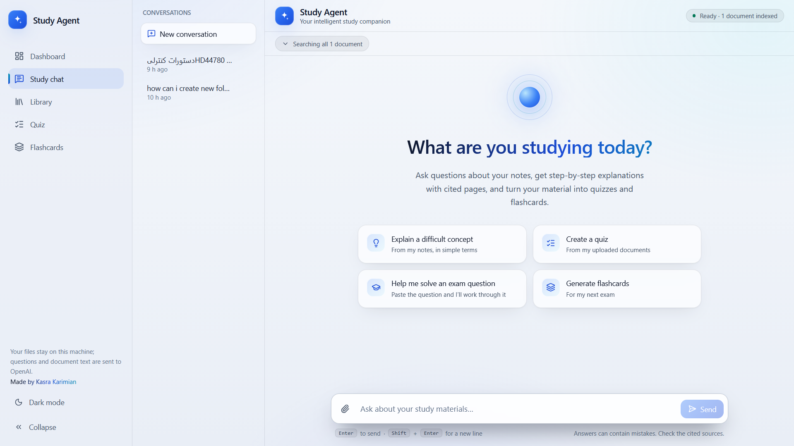

</div>


<p align="right">(<a href="#readme-top">back to top</a>)</p>

---

## 🕸️ The Agent Graph

Every chat message runs through a LangGraph `StateGraph`:

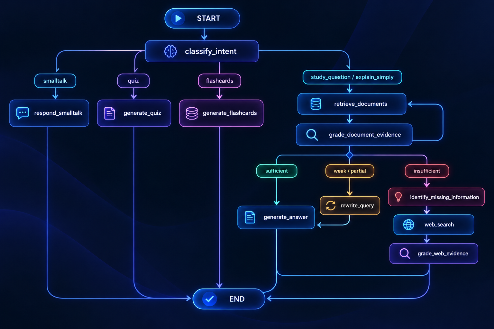

| Node | What it does |
|---|---|
| `classify_intent` | Labels the message (`study_question`, `explain_simply`, `quiz`, `flashcards`, `smalltalk`), detects whether the student *explicitly* wants external info, and rewrites the question so it stands alone without chat history. |
| `retrieve_documents` | Searches the vector index (or hybrid), optionally scoped to selected documents. On a retry it **merges** hits, so a rewrite can only add evidence. |
| `grade_document_evidence` | An LLM grader returns `sufficient`, `partial`, or `insufficient`, the relevant passages, what's missing, and whether a reworded search might help. |
| `rewrite_query` | Produces a better search query once; if the rewrite is no different, the agent skips straight to the next step instead of repeating the same search. |
| `identify_missing_information` | Narrows the gap down to a short, generic web query for *only* the missing part. |
| `web_search` | Calls Tavily if configured; otherwise records a clear limitation instead of failing. |
| `grade_web_evidence` | Keeps only results judged relevant and not low-reliability. |
| `generate_answer` | Streams an answer from the kept sources, then validates citations. If there is no evidence at all, it says so instead of guessing. |
| `generate_quiz` / `generate_flashcards` | Create study tools from selected (or most recent) documents — **never from the web**. |

Every node is wrapped in a `@traced` decorator that emits real start/finish events with durations to the stream. The UI timeline shows what **actually ran** — it never exposes model reasoning.

<p align="right">(<a href="#readme-top">back to top</a>)</p>

---

## 🔎 Retrieval

| Mode | How it works | When to use it |
|---|---|---|
| `vector` *(default)* | Cosine similarity over `text-embedding-3-small` embeddings stored in ChromaDB. | Conceptual questions and natural-language phrasing. |
| `hybrid` | Vector search + a small built-in **BM25** keyword search, merged with **reciprocal-rank fusion**. | Exact terms, equations, error codes, identifiers (e.g. `XJ-4471`). |

Notes:

- The similarity score is treated as a **relevance signal, not proof** — the LLM grader decides whether passages actually answer the question.
- Keyword-only hits are kept in hybrid mode even if their cosine score is low, since exact-term matches are the point.
- The index records which embedding model built it. Changing `OPENAI_EMBEDDING_MODEL` later raises a clear mismatch error until you rebuild the index.
- Before switching modes, measure it: `python -m app.evals.run --compare-retrieval`.

<p align="right">(<a href="#readme-top">back to top</a>)</p>

---

## 🧾 Citations You Can Trust

Answers are written with markers like `[D1]` (document passage) and `[W1]` (web result). The backend then:

1. Maps each marker to a **real retrieved chunk or real search result**.
2. Drops any marker the model made up.
3. Normalises grouped markers (`[D1, W2]` → `[D1][W2]`).
4. Builds the citation object (filename, page number, snippet, URL) **only from stored metadata** — never from model text.

The result also carries an `answer_origin` (`documents`, `web`, `documents_and_web`, or `none`) and an honest **limitations** note, for example when part of the question wasn't found, web search failed, or no source could be cited.

<div align="center">

<!-- 🖼️ IMAGE SLOT 9 — Close-up of a citation chip + the Sources panel showing a document snippet with page number and a web source -->
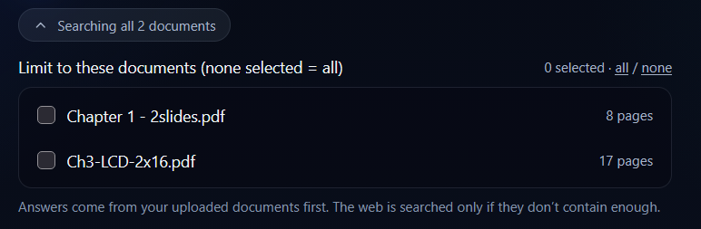

</div>

<p align="right">(<a href="#readme-top">back to top</a>)</p>

---

## 🧠 Quizzes, Flashcards & Progress

**Quizzes** — choose documents, difficulty, question count (up to 20 by default), and question types.

- Multiple-choice and true/false are marked automatically.
- Short-answer questions are graded by an LLM against a rubric, and flagged as an *estimate* in the results.
- Every question links back to its source document, page, and chunk.

**Flashcards** — generate decks (up to 30 cards by default) and rate each card **easy**, **medium**, or **difficult**.

**Progress** — computed directly from stored attempts and ratings, using a deliberately simple and transparent rule:

> A topic is flagged as weak when it has **at least 2 results** (answered quiz questions + rated flashcards) and **at least half** were answered incorrectly or marked *difficult*.

No "mastery score" is invented — the dashboard only reports what you got wrong or found hard, and explains the method on screen.

<p align="right">(<a href="#readme-top">back to top</a>)</p>

---

## 🧪 Evaluation Harness

The repo ships with a small evaluation set (`evals/questions.jsonl`, 12 questions) over four sample documents (`evals/documents/`: photosynthesis, Newton's laws, Big-O notation, a lab manual with codes). It uses a **temporary index**, so it never touches your own library.

```bash
cd backend
python -m app.evals.run                       # full run (uses API credit)
python -m app.evals.run --limit 5             # first 5 questions only
python -m app.evals.run --no-judge            # skip the LLM faithfulness judge
python -m app.evals.run --retrieval-only      # embeddings only, no chat calls
python -m app.evals.run --compare-retrieval   # vector vs hybrid
python -m app.evals.run --mode hybrid         # answer using hybrid retrieval
```

| Metric | What it measures |
|---|---|
| **Retrieval hit rate / MRR** | Did the expected document appear in the retrieved passages, and how high? |
| **Faithfulness** | Share of answers where an LLM judge found all claims supported, plus key-fact recall. |
| **Citation validity** | Deterministic check that every cited chunk exists, matches its file, and the quoted snippet really starts that chunk; web URLs must have been returned by the search provider. |
| **Web decision accuracy** | Used the web when needed, avoided it when not (missed vs. unnecessary calls are counted separately). |
| **Latency & tokens** | Mean / median / max latency and total token usage when reported. |

A JSON report is written to `evals/results/`.

### Results


| Metric | Vector | Hybrid |
|---|---:|---:|
| Retrieval hit rate | 1.0 | 1.0 |
| MRR | 1.0 | 1.0 |
| Faithful answers (all claims supported) | 1.0 | 0.9 |
| Valid citations | 1.0 | 1.0 |
| Web decision accuracy | 0.917 | 0.917 |

<div align="center">

<!-- 🖼️ IMAGE SLOT 11 — Terminal screenshot of `python -m app.evals.run` output, or a chart of vector vs hybrid -->
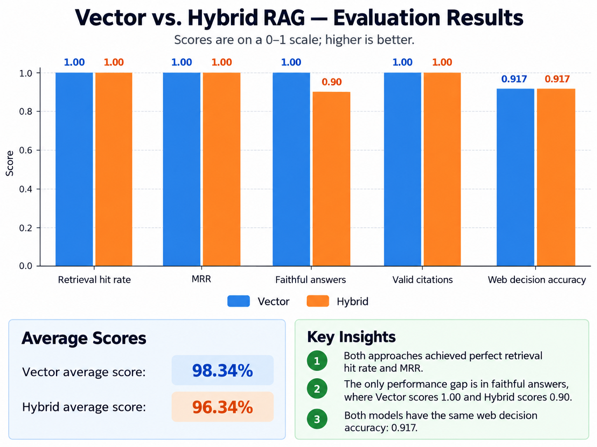

</div>

<p align="right">(<a href="#readme-top">back to top</a>)</p>

---

## 🧱 Tech Stack

<div align="center">


</div>

### Main Components

| Layer | Technology |
|---|---|
| API | FastAPI + Uvicorn, Pydantic v2 / pydantic-settings |
| Agent orchestration | LangGraph (`StateGraph`) with `langgraph-checkpoint-sqlite` |
| LLM & embeddings | Any OpenAI-compatible endpoint (default models: `gpt-4o-mini`, `text-embedding-3-small`) |
| Vector store | ChromaDB via `langchain-chroma` |
| Keyword search | Built-in BM25 + reciprocal-rank fusion |
| Document parsing | PyMuPDF (PDF), plain-text and Markdown loaders |
| Chunking | `RecursiveCharacterTextSplitter` (1000 chars, 150 overlap by default) |
| Web search | Tavily (optional, replaceable provider interface) |
| App database | SQLite + SQLAlchemy 2 (documents, conversations, quizzes, attempts, flashcards) |
| Frontend | React 19, React Router 7, TypeScript, Vite, Tailwind CSS 4, `react-markdown` + `remark-gfm`, Lucide icons |
| Testing | pytest (backend), Vitest + Testing Library (frontend) |
| Deployment | Docker Compose, Nginx serving the built SPA |

<p align="right">(<a href="#readme-top">back to top</a>)</p>

---

## 🏗️ Architecture

### System Overview

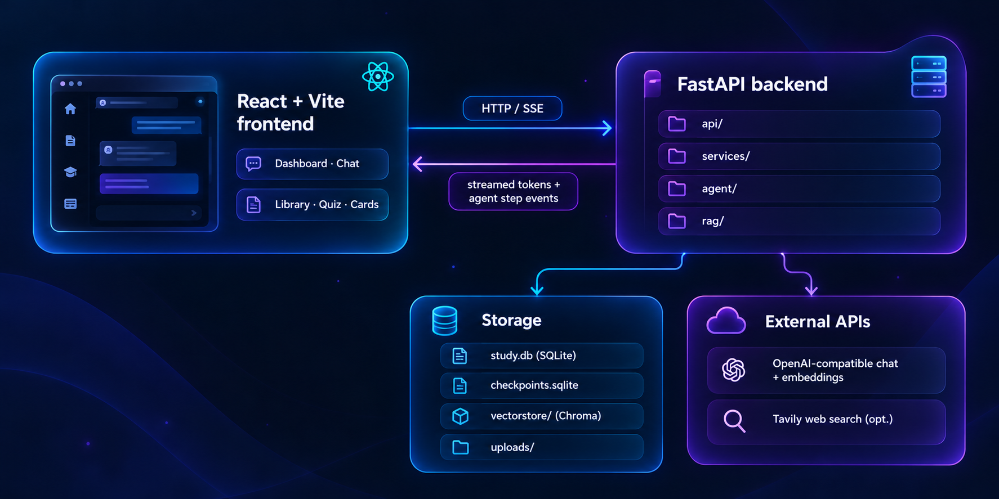

### Ingestion Flow

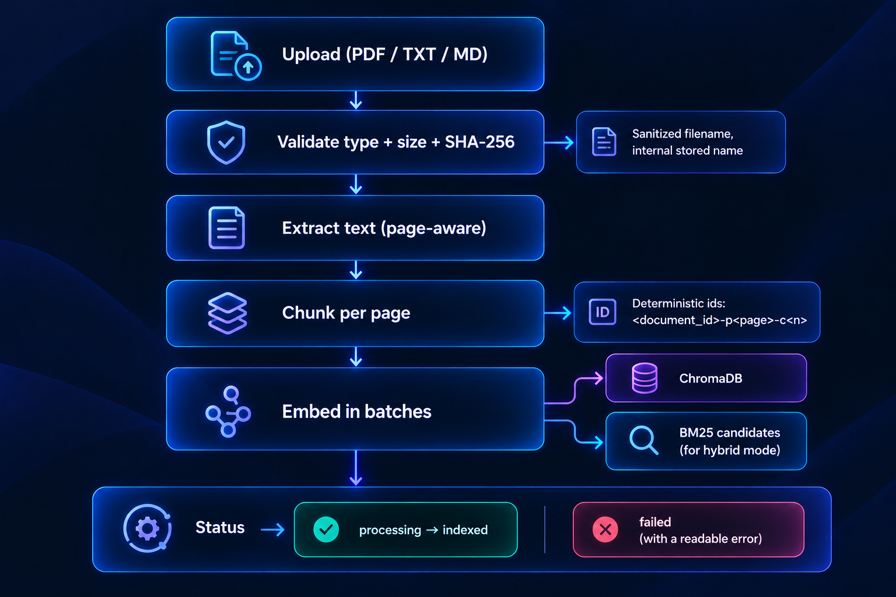

### Design Decisions

- **Document-first.** Documents are always searched first; the web is used only for what's missing, or when you explicitly ask for it.
- **Bounded everything.** Query rewrites, history length, upload size, page count, quiz size, and provider retries are all capped.
- **Single retry layer.** SDK-level retries are disabled so one bounded layer retries only *transient* provider errors; bad keys, missing credits, and unknown models fail immediately with sanitized messages.
- **Fail fast on config.** Missing keys or invalid settings stop startup with a clear message, not on the first request.
- **Untrusted web content.** Search results are treated as data, never as instructions.
- **Swappable providers.** The agent depends on a `WebSearchProvider` protocol, so another search backend can be added without touching the graph.
- **Crash recovery.** Documents left mid-indexing by a crash are marked `failed` on the next startup.
- **Dependency injection for tests.** `create_app()` accepts fake chat models, embeddings, and search providers.

<p align="right">(<a href="#readme-top">back to top</a>)</p>

---

## 🚀 Getting Started

### Prerequisites

- An **OpenAI-compatible API key** (required). API billing is separate from a ChatGPT subscription.
- A **Tavily API key** (optional) for the web-search fallback.
- **Docker + Docker Compose**, *or* **Python 3.11+** and **Node 22+** for a manual setup.

### Option A — Docker (recommended)

```bash
git clone https://github.com/kasrakr/Study-Agentic-AI.git
cd Study-Agentic-AI

cp backend/.env.example backend/.env
# edit backend/.env → set OPENAI_API_KEY (and OPENAI_BASE_URL, optionally TAVILY_API_KEY)

docker compose up --build
```

Open **http://localhost:5173** — the API runs on **http://localhost:8000** (interactive docs at `/docs`).
Your documents, index, and chats persist in `./storage`.

### Option B — Run locally

**Backend**

```bash
cd backend
python -m venv .venv
source .venv/bin/activate          # Windows: .venv\Scripts\activate
pip install -e ".[dev]"

cp .env.example .env               # then set OPENAI_API_KEY
uvicorn app.main:create_app --factory --reload
```

**Frontend** (in a second terminal)

```bash
cd frontend
cp .env.example .env               # VITE_API_BASE_URL=http://localhost:8000
npm install
npm run dev
```

### First run checklist

1. Open the **Dashboard** and confirm the backend shows as connected.
2. Use **Check OpenAI** on the dashboard (or `GET /api/health/openai`) to verify your key, models, and billing with two tiny real calls.
3. Go to **Library** and upload a PDF, `.txt`, or `.md` file; wait for it to show as *indexed*.
4. Open **Study chat** and ask a question about your document.

<div align="center">

<!-- 🖼️ IMAGE SLOT 12 — Dashboard system-status card showing the green "connected / OpenAI OK" state -->
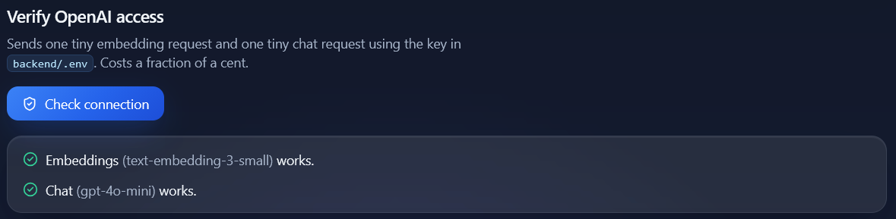

</div>

<p align="right">(<a href="#readme-top">back to top</a>)</p>

---

## 🔧 Configuration

All settings come from environment variables (or `backend/.env`) and are defined in one place: `backend/app/config.py`.

| Variable | Default | Description |
|---|---|---|
| `OPENAI_API_KEY` | *(required)* | Key for the configured endpoint. |
| `OPENAI_BASE_URL` | `https://api.gapgpt.app/v1` | OpenAI-compatible endpoint used for chat **and** embeddings. Set to `https://api.openai.com/v1` to use OpenAI directly. |
| `OPENAI_CHAT_MODEL` | `gpt-4o-mini` | Model used for every LLM operation. |
| `OPENAI_EMBEDDING_MODEL` | `text-embedding-3-small` | Changing it later requires rebuilding the vector index. |
| `OPENAI_TIMEOUT_SECONDS` / `OPENAI_MAX_RETRIES` | `60` / `2` | Provider timeout and bounded retries. |
| `TAVILY_API_KEY` | *(empty)* | Enables the web fallback. Without it, unanswerable questions get a clear limitation instead. |
| `TAVILY_MAX_RESULTS` / `TAVILY_TIMEOUT_SECONDS` | `5` / `10` | Web search limits. |
| `DATABASE_URL` | `sqlite:///storage/study.db` | App database. |
| `CHROMA_PERSIST_DIRECTORY` | `storage/vectorstore` | Vector index location. |
| `CHECKPOINT_DATABASE` | `storage/checkpoints.sqlite` | LangGraph conversation state. |
| `UPLOAD_DIRECTORY` | `storage/uploads` | Uploaded files. |
| `CORS_ORIGINS` | `http://localhost:5173,http://127.0.0.1:5173` | Allowed browser origins. |
| `MAX_UPLOAD_SIZE_MB` / `MAX_DOCUMENT_PAGES` | `25` / `500` | Ingestion limits. |
| `CHUNK_SIZE` / `CHUNK_OVERLAP` | `1000` / `150` | Chunking. Overlap must be smaller than size. |
| `RETRIEVAL_TOP_K` | `6` | Passages retrieved per search. |
| `RETRIEVAL_MIN_SCORE` | `0.0` | Drop passages below this cosine similarity (`0` disables). |
| `RETRIEVAL_MODE` | `vector` | `vector` or `hybrid`. |
| `RETRIEVAL_WEAK_SCORE` | `0.25` | Top similarity below this is flagged as a weak-retrieval signal. |
| `MAX_RETRIEVAL_RETRIES` | `1` | Query rewrites per question before the web fallback. |
| `AGENT_HISTORY_MESSAGES` | `6` | Prior messages given to the classifier. |
| `QUIZ_MAX_QUESTIONS` / `FLASHCARD_MAX_CARDS` | `20` / `30` | Generation caps. |
| `GENERATION_CONTEXT_CHUNKS` | `24` | Passages sampled for each quiz or deck. |
| `LOG_LEVEL` | `INFO` | Logging level (keys are redacted from logs). |
| `VITE_API_BASE_URL` *(frontend)* | `http://localhost:8000` | Backend URL **as reachable by the browser**. |

<p align="right">(<a href="#readme-top">back to top</a>)</p>

---

## 🔌 API Reference

Interactive Swagger docs are available at **`/docs`** once the backend is running. Errors always use one shape: `{"error": {"code", "message", "details"}}`.

| Area | Method & path | Purpose |
|---|---|---|
| **Health** | `GET /api/health` | Cheap liveness check (no OpenAI calls, never returns key values). |
| | `GET /api/health/openai` | Two tiny real calls to verify key, models, and billing. |
| **Documents** | `POST /api/documents/upload` | Upload and index a PDF / TXT / Markdown file. |
| | `GET /api/documents` | List documents and their indexing status. |
| | `GET /api/documents/{id}` | Document details. |
| | `GET /api/documents/{id}/file` | Download the original file. |
| | `DELETE /api/documents/{id}` | Delete a document and its vectors. |
| **Chat** | `POST /api/chat` | Ask a question and get the full answer. |
| | `POST /api/chat/stream` | Same, streamed as Server-Sent Events (tokens + agent step events). |
| **Conversations** | `GET /api/conversations` | List conversations. |
| | `GET /api/conversations/{id}` | Conversation history. |
| | `DELETE /api/conversations/{id}` | Delete a conversation. |
| **Quizzes** | `POST /api/quizzes/generate` | Generate a quiz from selected documents. |
| | `GET /api/quizzes/{id}` | Fetch a quiz. |
| | `POST /api/quizzes/{id}/submit` | Submit answers and get a graded result. |
| **Flashcards** | `POST /api/flashcards/generate` | Generate a deck. |
| | `GET /api/flashcards/{id}` | Fetch a deck. |
| | `PUT /api/flashcards/cards/{id}/difficulty` | Rate a card easy / medium / difficult. |
| **Progress** | `GET /api/progress` | Quiz and flashcard stats, weak topics, recent activity. |

<p align="right">(<a href="#readme-top">back to top</a>)</p>

---

## ✅ Testing

```bash
# Backend (fully mocked: no API keys or network needed)
cd backend
pytest

# Frontend
cd frontend
npm test            # vitest
npm run typecheck   # tsc --noEmit
npm run build       # typecheck + production build
```

The backend suite (about 180 tests) covers the agent graph and routing, hybrid retrieval, loaders and chunking, document API, streaming and conversations, quizzes, flashcards, progress, error handling and retries, config validation, web search, evaluation metrics, and an end-to-end flow. All tests use injected fake models, so they run offline.

**Try the UI without API keys** (scripted answers, for development only):

```bash
cd backend
python scripts/fake_server.py --port 8766 --tavily
```

`scripts/smoke_live.py` runs a smoke test against a live server.

<p align="right">(<a href="#readme-top">back to top</a>)</p>

---

## 📂 Project Structure

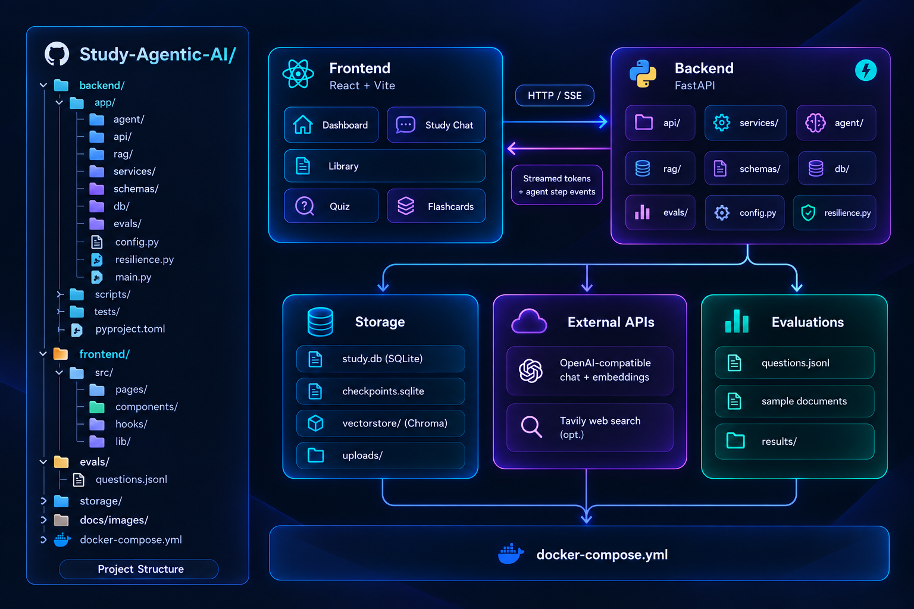

<p align="right">(<a href="#readme-top">back to top</a>)</p>

---

## ⚠️ Limitations

- **Single user, no authentication** — intended for local use.
- **Supported files:** PDF, `.txt`, `.md` / `.markdown`. **Scanned PDFs are not supported** (no OCR). Password-protected PDFs are rejected.
- **Privacy:** files stay local, but questions and document text are sent to your configured OpenAI-compatible provider (and queries to Tavily when the web fallback runs).
- **AI-graded short answers** are estimates; multiple-choice and true/false are marked deterministically.
- **Topic labels** for weak-topic detection are written by the model, so similar topics may be split.
- Changing the embedding model requires deleting `storage/vectorstore` and re-uploading your documents.

<p align="right">(<a href="#readme-top">back to top</a>)</p>

---

## 📄 License

Distributed under the **MIT License**. See [`LICENSE`](./LICENSE) for details.

<p align="right">(<a href="#readme-top">back to top</a>)</p>

---

## 📬 Contact

**Kasra Karimian**

<div align="center">

<a href="https://github.com/kasrakr">
  
</a>
<a href="https://linkedin.com/in/kasrakarimian">
  
</a>
<a href="https://t.me/lowkasra">
  
</a>

</div>

<p align="right">(<a href="#readme-top">back to top</a>)</p>

---

<details>
<summary>⭐ Star History</summary>

</details>

<div align="center">

If this project helped you study or you found the agent workflow useful, consider giving the repository a ⭐

</div>


